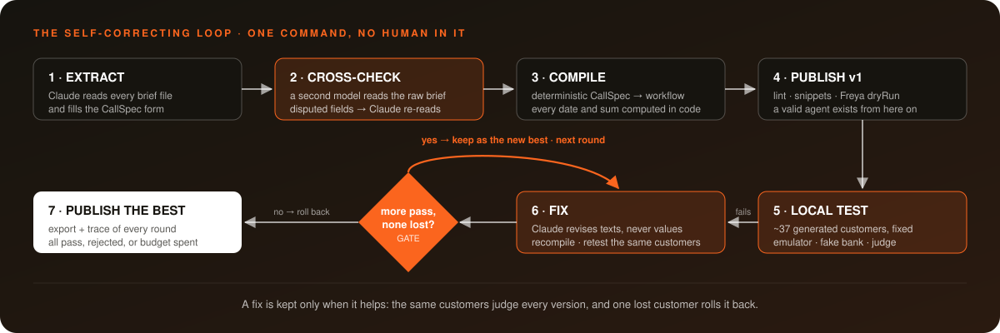
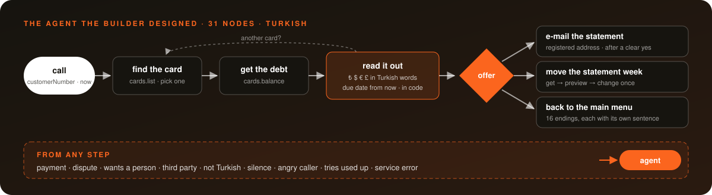
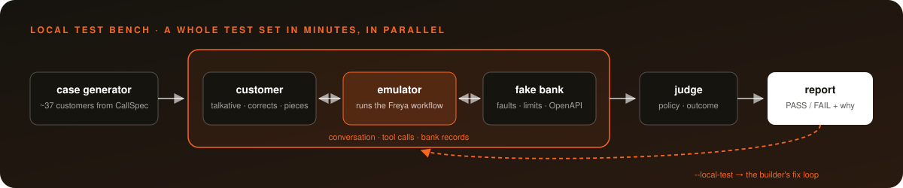

<p align="center">
  
</p>

<p align="center">
  
  
  
  
  
  
</p>

<p align="center">
  <b>A bank sends its documents. Our builder sends back a working phone agent.</b><br>
  No hand edits. One command. Every decision written to a trace.<br><br>
  <b>Finished 13th among all teams in the Freya × Y Combinator hackathon.</b>
</p>

---

## The heart of it: a builder that corrects itself

Writing an agent once is easy. Writing one that is **right** is the hard part. So our builder does not stop after the first draft. It tests its own agent, reads why customers failed, fixes itself and keeps the fix **only if it really helps**. All inside one command, with no human in the loop.

<p align="center"></p>

```bash
python3 main.py <brief file or folder> <tool openapi.json>
```

### What makes the loop work

| Idea | How |
|---|---|
| **Two readers, not one** | After Claude fills the CallSpec, a second model (GPT) reads the raw brief on its own. Every field where the two readings disagree goes back to Claude, which re-reads the brief for exactly those fields and writes down why it kept or changed each one. |
| **Customers with exact answers** | Test customers are generated from the CallSpec: about 30 single-product and 7 multi-product cases. Every expected date and amount is computed in code (bands, deadlines, business days, holidays, floors), so a judge has a hard answer to check against, not an opinion. |
| **The same customers for the whole run** | The set is fixed once. Every version of the agent is measured against the same customers, so "better" means better. |
| **Fixes change words, never facts** | The failed transcripts, the bank-record diff and the judge's reasons go to Claude. Claude may rewrite texts and instructions; the brief's values (dates, limits, amounts) stay exactly as extracted. |
| **A gate that cannot be fooled** | A fix is accepted only if **more customers pass and none that passed before fails**. One lost customer, and the builder rolls back to the best version and stops. |
| **Always something to submit** | Version 1 is published before testing starts, so a valid agent exists from minute one. The loop ends when all pass, a fix is rejected, or the time budget is spent. |
| **Everything on the record** | Every round writes its request, the CallSpec diff, the test result and the decision (`fixN.decision.json`). Every model conversation is saved under `chats/`. |

### The loop at work (real traces)

The cross-check settling a conflict between a mail and a memo on its own:

> *"attempt2_rule: kept. 01-email-thread.md CPM rev. 9 section 4.8 gives attempt 2 (floor on the latest date) for overdue and serious; 02-memo-changes.md item 2 cuts serious to one attempt, so attempt 2 is for the overdue band only. The second reader says the same thing in other words."*
> <sub>[`runs/deneme-c/20261011-171829/recheck.result.json`](runs/deneme-c/20261011-171829/recheck.result.json)</sub>

The gate stopping a fix that looked good but broke two passing customers:

```
fix1: rejected, 2/10 -> 0/10, newly failing: DENEME-04, DENEME-18; keeping v1
```
<sub>[`traces/20261011-163126-deneme-e.txt`](traces/20261011-163126-deneme-e.txt)</sub>

> **Nothing about any bank or brief is written into the code.** Every rule, value and sentence comes from the documents at run time.

---

## The problem

A bank wants software to answer its phone calls. Before that software can talk to a single customer, someone has to read the bank's material and turn it into a working agent: who to ask for, what to say, which dates are allowed, what to do when a service fails. The material is spread across a dozen documents, written months apart, and the documents contradict each other. **Done by hand, one bank takes days.**

Our builder does that work by itself, and checks its own work.

---

## Fallback: a call type outside the template

The CallSpec describes one family of calls. When a bank's tool API has none of the tools that family needs, the builder does not crash. It **falls back to a free-form path**: Claude reads the whole case pack, writes a design note, then the workflow; the builder checks it (JSON, lint, code compiles, URLs only inside the tool API, Freya dryRun) and sends every problem back until Freya accepts it.

### The final case went through the fallback

The hidden final case was a different kind of call: **an inbound credit-card statement call, in Turkish.** The agent finds the right card, reads the statement debt in **lira, dollars, euros and pounds**, says when it is due, can **move the statement week** and **e-mail the statement PDF**, and hands callers who want to pay or speak to a person to an agent. The material was mails, two versions of an analysis document, meeting transcripts, a service contract, an IVR sheet, an FAQ and a flow drawing, and they did not agree.

<table>
<tr>
<td align="center"><h2>7</h2>services in a tool API written from the contract</td>
<td align="center"><h2>12</h2>conflicts between sources found and resolved</td>
<td align="center"><h2>31</h2>nodes in the Turkish workflow</td>
<td align="center"><h2>1st</h2>round accepted by Freya</td>
</tr>
</table>

<p align="center"></p>

- **Amounts and dates in code:** exact Turkish text with amounts in words, kuruş, sent and peni, and the right suffix; "the due date has passed" is decided from `now`.
- **The card number is never rebuilt from speech:** a pre-hook maps the caller's choice to the masked number the bank returned.
- **Write calls run once, only after a clear yes**, and every service error has its own path.

<details>
<summary><b>The 12 conflicts the builder resolved (latest decision wins)</b></summary>

| Topic | Decision |
|---|---|
| Silence | the 3rd silence ends the call |
| Out of scope | ask before transferring to the main menu |
| Angry caller | three calming replies, then an agent |
| Tries used up | a fixed sentence, then the main menu |
| Duplicate cards | ask for the last six digits, then the full number |
| Card digits | only the last four are ever spoken |
| Currencies | always said with their full names |
| No-debt sentence | follows the 8 October rule; missing currency blocks are left out |
| Week change limit | once a year, no pre-check service; any refusal goes to an agent |
| Joint-card warning | said before "Onaylıyor musunuz?" |
| E-mail lookup | done before the offer |
| E-mail address | only the registered address |

Full note: [`FREYA/out/final.freeform.notes.md`](FREYA/out/final.freeform.notes.md)
</details>

---

## Our own bank: the mock

The final case also asked teams to host the bank's services themselves. [`mock/`](mock/) is a **Cloudflare Worker** with all 7 services. It uses the exact paths, field names and request and response shapes of the integration document, and it returns the stored answer, HTTP status included, for every test customer.

---

## Testing without waiting for the platform

Freya allows one simulation at a time per workspace, and the platform was limited during the final. So we built a **local test bench** that runs a whole test set in parallel in minutes.

<p align="center"></p>

| Tool | What it does |
|---|---|
| [`emulator.py`](tester/emulator.py) | Runs a Freya workflow locally and reports any Freya feature it cannot emulate |
| [`fakebank.py`](tester/fakebank.py) | A local bank: every identity field, injected faults, wrong-answer limit, field-name mapping, OpenAPI checks |
| [`cases_from_callspec.py`](tester/cases_from_callspec.py) | Generates single- and multi-product customers; every date and amount computed in code |
| [`local_sim.py`](tester/local_sim.py) / [`local_test.py`](tester/local_test.py) | Runs the set, in parallel and with repetitions; the builder can call it |
| [`rule_diff.py`](tester/rule_diff.py) | A second model reads the raw brief on its own; diffs it against the CallSpec field by field |
| [`run_coverage.py`](tester/run_coverage.py) | The official path on Freya, with retries on platform errors |

<table>
<tr>
<td align="center"><h2>26 / 28</h2>same verdict as the real platform<br/><sub>both differences: platform-model behaviour, not the workflow</sub></td>
<td align="center"><h2>4</h2>rehearsal briefs we wrote ourselves<br/><sub>built blind, each with an answer key</sub></td>
<td align="center"><h2>62 s</h2>to build Brief C<br/><sub>extraction caught all 6 memo items, rule diff: 0</sub></td>
</tr>
</table>

---

## Repository

```
main.py                    the self-correcting run: extract → cross-check → compile → test → fix → gate
FREYA/                     the builder
├── builder/build.py       submission entry point
├── builder/main.py        read → plan → build → check → publish → trace
├── builder/extract/       reading material · CallSpec extraction · contract → OpenAPI
├── builder/compile/       compiler · code generation · lint · self-check
├── builder/test/          practice runs and the fixer
├── builder/freeform.py    fallback for call types outside the template
├── submission/            exported workflows (final.workflow.json is our entry)
├── traces/                one trace per run
└── out/                   everything a run wrote: OpenAPI, design note, workflow
tester/                    local test bench: emulator, fake bank, case generator, judge
mock/                      Cloudflare Worker: the bank's services
test-briefs/               our rehearsal briefs C–F with answer keys
watch.py                   live browser view of a running build
submission.json            the submission form
```

---

## Run it

```bash
pip install -r FREYA/requirements.txt
cp FREYA/kit/env.example env.sh   # FREYA_API_KEY · FREYA_BANK_TEAM_KEY · FREYA_WORKSPACE_ID · ANTHROPIC_API_KEY
source env.sh
cd FREYA

# the self-correcting run on a brief
python3 ../main.py kit/briefs/brief-a.md kit/tools/openapi.json --cross-check

# the final case, against our mock
python3 builder/build.py ../final/case https://freya-mock.freya-hecaton.workers.dev 2>&1 | tee traces/final.log

# a practice brief, with tests and a fix round
python3 builder/build.py kit/briefs/brief-a.md kit/tools/openapi.json --test A --fix-rounds 1

# watch a build live → http://localhost:8765
python3 ../watch.py
```

Each run ends with `{"workflow_id", "agent_id", "export"}` and writes its trace to `FREYA/traces/`.

---

<p align="center">
  <b>Team MOSES</b><br>
  <a href="https://github.com/Dora-19">Dora Alkan</a> · builder & mock &nbsp;|&nbsp; <a href="https://github.com/menes000">Mehmet Enes Arslan</a> · test bench<br><br>
  <sub>Built with Claude Code · phone agents run on Freya · made for the Freya × Y Combinator "Build the Builder" hackathon, October 2026</sub>
</p>
