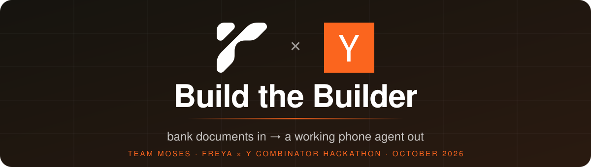
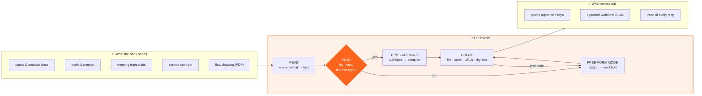
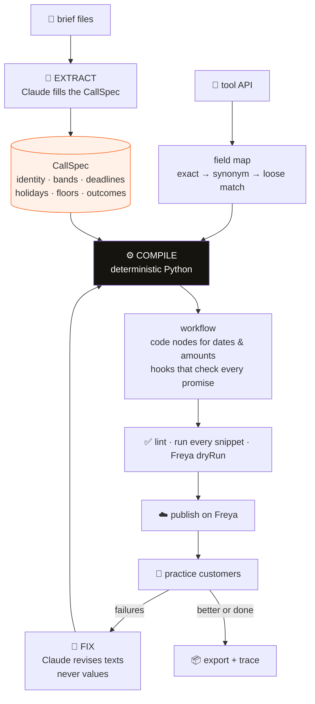
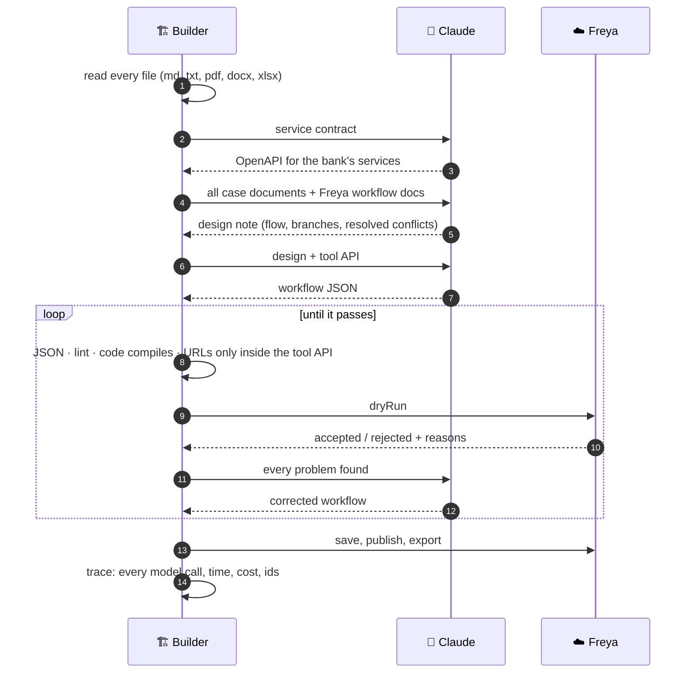
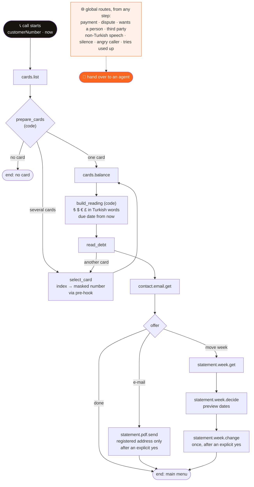
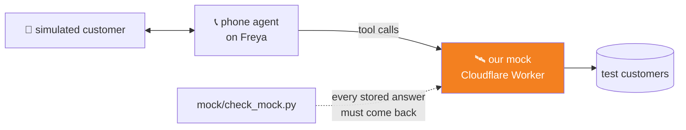
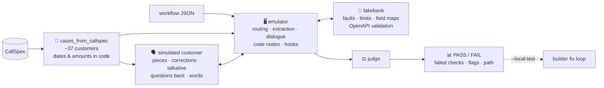

<p align="center">
  
</p>

<p align="center">
  
  
  
  
  
</p>

<p align="center">
  <b>A bank sends its documents. Our builder sends back a working phone agent.</b><br>
  No hand edits. One command. Every decision written to a trace.
</p>

---

## ⚡ In one picture



```bash
python3 FREYA/builder/build.py <case folder | zip | brief>  <mock_url | openapi.json>
```

---

## 🎯 The problem

A bank wants software to answer its phone calls. Before that software can talk to a single customer, someone has to read the bank's material and turn it into a working agent: who to ask for, what to say, which dates are allowed, what to do when a service fails. The material is spread across a dozen documents, written months apart, and the documents contradict each other. **Done by hand, one bank takes days.**

Our builder does that work by itself.

---

## 🧠 Two modes, one builder

The builder looks at the bank's tool API and decides on its own how to build.

<table>
<tr>
<th width="50%">🧩 Template mode</th>
<th width="50%">🚀 Free-form mode</th>
</tr>
<tr>
<td valign="top">

**For a call type the builder knows** (outbound collections: identity check, debt, payment promise).

1. Claude fills a **CallSpec**, a fixed form of the bank's rules.
2. A **deterministic compiler** turns it into a Freya workflow.
3. Every date, amount, limit and holiday is **computed in code**, never guessed by the model.
4. Practice customers run against it. A fix loop revises the texts and keeps a change only when more customers pass.

</td>
<td valign="top">

**For a call type the builder has never seen.**

1. Claude reads **the whole case pack**: mails, memos, transcripts, contract, PDF.
2. It resolves conflicts between sources (**the latest decision wins**) and writes a design note.
3. It writes the Freya workflow from that design.
4. The builder checks it and **sends every problem back** until Freya accepts it.

</td>
</tr>
</table>

> 🔒 **Nothing about any bank or case is written into the code.** Every rule, value and sentence comes from the documents at run time.

---

## 🔍 Inside a build

### Template mode



### Free-form mode



---

## 🏁 The final case

The hidden final case was a call type nobody had practised: **an inbound credit-card statement call, in Turkish.** The phone menu has already identified the caller. The agent finds the right card, reads the statement debt in **lira, dollars, euros and pounds**, says when it is due, can **move the statement week** and can **e-mail the statement PDF**. Callers who want to pay or ask for a person are handed to an agent.

The material: mails, two versions of an analysis document, meeting transcripts, a service contract, an IVR prompt sheet, an FAQ and a flow drawing. The sources did not agree with each other.

### What the builder produced, in one run, with no hand edits

<table>
<tr>
<td align="center"><h2>7</h2>services in a tool API it wrote from the contract</td>
<td align="center"><h2>12</h2>conflicts between sources found and resolved</td>
<td align="center"><h2>31</h2>nodes in the Turkish workflow</td>
<td align="center"><h2>1st</h2>round accepted by Freya</td>
</tr>
</table>

### The agent it designed



### Design choices that matter

- 🔢 **Amounts and dates are computed in code, not by the model.** Code nodes write the exact Turkish text: amounts in words, kuruş, sent and peni, the right suffix, "the due date has passed" and "the statement was cut today", all decided from `now`.
- 💳 **The card number is never rebuilt from what the caller said.** A pre-hook maps the caller's choice to the masked number that `cards.list` returned.
- ✋ **Write calls run once, and only after a clear yes.** This applies to `statement.week.change` and `statement.pdf.send`.
- 🧯 **Every service error has a path.** Failure counters, return-code checks and status variables reset after use, so an old result never fires twice.
- 🎙️ **16 closing nodes**, each with its own sentence and end reason.

<details>
<summary><b>The 12 conflicts the builder resolved (latest decision wins)</b></summary>

| Topic | Decision |
|---|---|
| Silence | the 3rd silence ends the call |
| Out of scope | ask before transferring to the main menu |
| Angry caller | three calming replies, then an agent |
| Tries used up | a fixed sentence, then the main menu |
| Duplicate cards | ask for the last six digits, then the full number |
| Card digits | only the last four are ever spoken |
| Currencies | always said with their full names |
| No-debt sentence | follows the 8 October rule; missing currency blocks are left out |
| Week change limit | once a year, no pre-check service; any refusal goes to an agent |
| Joint-card warning | said before "Onaylıyor musunuz?" |
| E-mail lookup | done before the offer |
| E-mail address | only the registered address |

Full note: [`FREYA/out/final.freeform.notes.md`](FREYA/out/final.freeform.notes.md)
</details>

---

## 🛰️ Our own bank: the mock

The final case also asked teams to host the bank's services themselves. [`mock/`](mock/) is a **Cloudflare Worker** with all 7 services. It uses the exact paths, field names and request and response shapes of the integration document, and it returns the stored answer, HTTP status included, for every test customer.



---

## 🧪 Testing without waiting for the platform

Freya allows one simulation at a time per workspace, and the platform was limited during the final. So we built a **local test bench** that runs a whole test set in parallel in minutes.



| Tool | What it does |
|---|---|
| [`emulator.py`](tester/emulator.py) | Runs a Freya workflow locally and reports any Freya feature it cannot emulate |
| [`fakebank.py`](tester/fakebank.py) | A local bank: every identity field, injected faults, wrong-answer limit, field-name mapping, OpenAPI checks |
| [`cases_from_callspec.py`](tester/cases_from_callspec.py) | Generates single- and multi-product customers; every date and amount computed in code |
| [`local_sim.py`](tester/local_sim.py) / [`local_test.py`](tester/local_test.py) | Runs the set, in parallel and with repetitions; the builder can call it |
| [`rule_diff.py`](tester/rule_diff.py) | A second model reads the raw brief on its own; diffs it against the CallSpec field by field |
| [`run_coverage.py`](tester/run_coverage.py) | The official path on Freya, with retries on platform errors |

<table>
<tr>
<td align="center"><h2>26 / 28</h2>same verdict as the real platform<br/><sub>both differences: platform-model behaviour, not the workflow</sub></td>
<td align="center"><h2>4</h2>rehearsal briefs we wrote ourselves<br/><sub>built blind, each with an answer key</sub></td>
<td align="center"><h2>62 s</h2>to build Brief C<br/><sub>extraction caught all 6 memo items, rule diff: 0</sub></td>
</tr>
</table>

---

## 📁 Repository

```
FREYA/                  🏗️ the builder
├── builder/build.py       submission entry point
├── builder/main.py        read → plan → build → check → publish → trace
├── builder/extract/       reading material · CallSpec extraction · contract → OpenAPI
├── builder/compile/       compiler · code generation · lint · self-check
├── builder/freeform.py    free-form mode: design → workflow → checks → feedback
├── builder/test/          practice runs and the fix loop
├── submission/            exported workflows (final.workflow.json is our entry)
├── traces/                one trace per run
└── out/                   everything a run wrote: OpenAPI, design note, workflow
mock/                   🛰️ Cloudflare Worker: the bank's services
tester/                 🧪 local test bench
test-briefs/            📝 our rehearsal briefs C–F with answer keys
watch.py                👀 live browser view of a running build
submission.json         📮 the submission form
```

---

## ▶️ Run it

```bash
pip install -r FREYA/requirements.txt
cp FREYA/kit/env.example env.sh   # FREYA_API_KEY · FREYA_BANK_TEAM_KEY · FREYA_WORKSPACE_ID · ANTHROPIC_API_KEY
source env.sh
cd FREYA

# the final case, against our mock
python3 builder/build.py ../final/case https://freya-mock.freya-hecaton.workers.dev 2>&1 | tee traces/final.log

# a practice brief, with tests and a fix round
python3 builder/build.py kit/briefs/brief-a.md kit/tools/openapi.json --test A --fix-rounds 1

# watch a build live → http://localhost:8765
python3 ../watch.py
```

Each run ends with `{"workflow_id", "agent_id", "export"}` and writes its trace to `FREYA/traces/`.

---

<p align="center">
  <b>Team MOSES</b><br>
  <a href="https://github.com/Dora-19">Dora Alkan</a> · builder & mock &nbsp;|&nbsp; <a href="https://github.com/menes000">Mehmet Enes Arslan</a> · test bench<br><br>
  <sub>Built with Claude Code · phone agents run on Freya · made for the Freya × Y Combinator "Build the Builder" hackathon, October 2026</sub>
</p>
